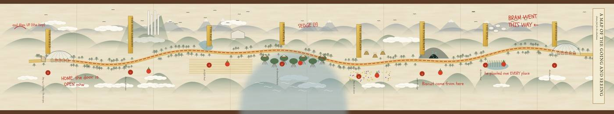
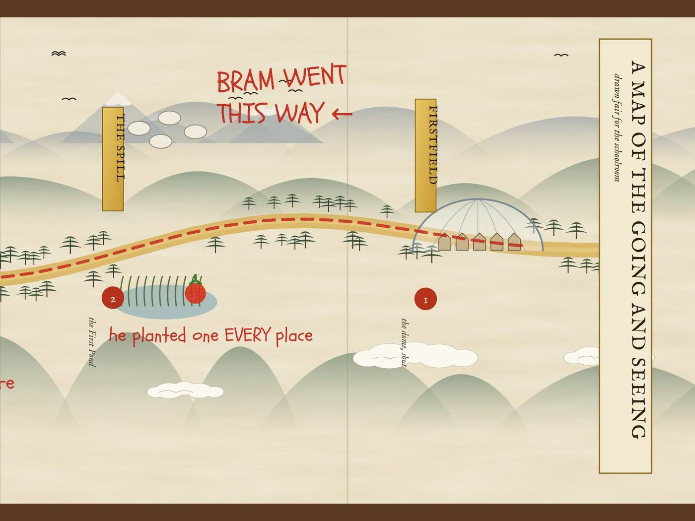
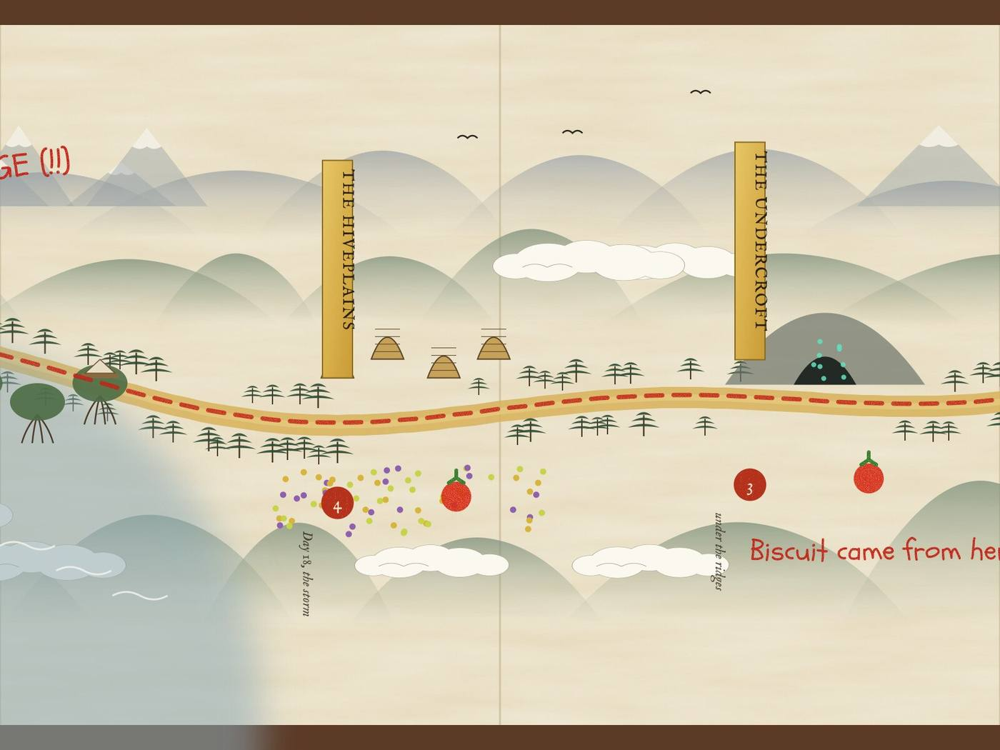
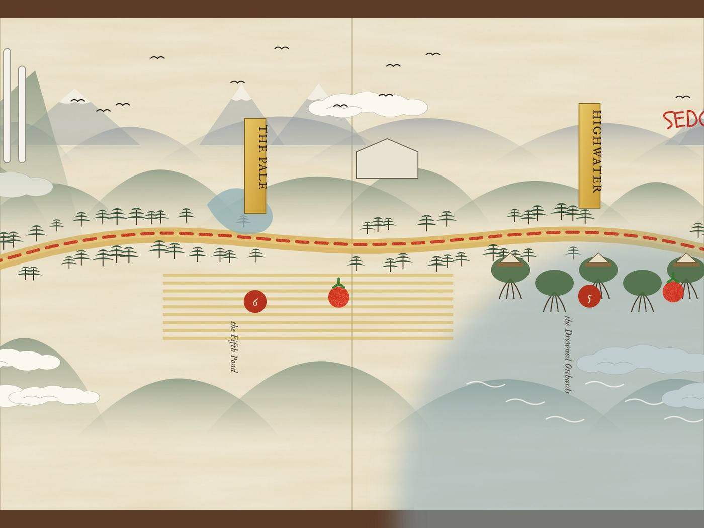
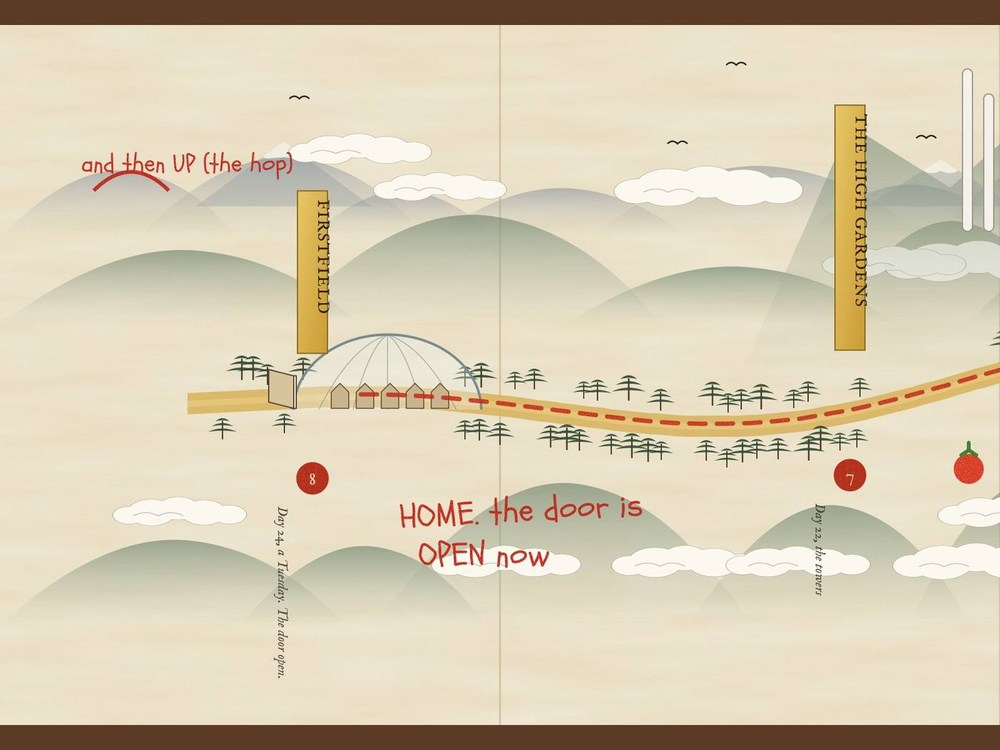

# Starter kit: gazetteer and map

Spoilers ahead.

## The map

One long scroll, read from right to left: the first picture shows all of it; the four after it unroll it an arm's width at a time.

## Gazetteer

> *Drawn fair for the schoolroom, after the fashion of the old road scrolls, which are read from right to left. Annotated in crayon by a member of the class, without permission.*
>
> — note pinned beside the map, Firstfield schoolhouse

The map is one long scroll. The first picture shows all of it; the four after it unroll it an arm's width at a time, from the right-hand end, where the road begins.

---

## Firstfield

*Heritage village of the Moriel Preserve, under a dome of glass. About two hundred people (the Register says 211); forty-one houses; eight generations.*

A village kept the old way, so that the people of Moriel can watch the past do its chores from the skywalks above, which the villagers call the Shining. There is a bakehouse with a crock older than anyone, a schoolhouse with one room, a meeting house with a long stair behind it, Saul's rows at the east end, and the Window, where the children breathe on the glass on Tuesdays and draw. Nobody taps the glass.

> [in crayon:] *we live here. it is the best one*

## The Spill

*Wild country beyond the farm cut, forty kilometres north of the Preserve. Ridges that go purple at dusk.*

Where the gold grain stops at a line as straight as a knife, the wild begins: fur-bark trees, a dark quick stream, a ravine, and a green-gold pond whose reeds lean away from warmth. Sky-grazers drift over it at dusk, long and pale, floating on their own gas. Lately they have been falling.

> [in crayon:] *the goats FLOAT. bram says*

## The Undercroft

*Fungal caverns under the ridges. Cold, dripping and very large.*

A dark country under the ground, lit blue-green by gills of fungus taller than the meeting house, where a network of threads carries messages for miles. Lantern-otters live here, six-legged, with glowing throats, and they will steal your lunch.

> [in crayon:] *Biscuit came from here*

## The Hiveplains

*Former pollination plantations. Owner lapsed.*

Rolling meadows of engineered flowers, hives the size of barns, bees the length of a thumb, and air thick with gold dust and humming. The Register says everything here is steady.

## The Drowned Orchards

*Tidal forest of flooded orchard stock on the north-west coast. The Register lists it as uninhabited.*

Fruit trees standing on stilt roots in water that rises and falls twice a day. In the canopy, on platforms of woven branch and sailcloth joined by rope bridges, is the village of **Highwater**, which the Register did not know about. Its people climb like breathing and dive for minutes at a time, and they do not trust anyone who smells of the dome.

> [in crayon:] *SEDGE (!!)*

## The Pale

*The gold grain plains. Company country: stations, drones and irrigation spines to the horizon.*

One crop from edge to edge, and the place where the drift began. There are rust-coloured patches now, and seed that will not set. Out in it stands an old station the colour of bone, with a pond beside it that nobody has looked at in sixty years.

## The High Gardens

*Cloud forest on the ridges above the Preserve. Where the sky-grazers breed.*

The most beautiful place on the map and the most dangerous. By day the cloud climbs the ridge, and at dusk the cold air pours back down. In the mist, sound lies about direction and smell does not. A waterfall turns to mist before it lands. The white towers of the Upper House stand up out of it like the bones of a hand.

## Margin Station

*Off the edge of this map.*

A station of about eleven thousand people, nine hours away by hop, and home of the Inspectorate of Discrepancies. Ring Two has a viewport with a sign on it.

> [in crayon:] *and then UP*

## Place cards

### Firstfield

*Also called: the Heritage Village, the village, home.*

> Ours are red, they're small, and they just sit there: the only tomatoes on Moriel that don't hum.

- **Senses:** the bakehouse crock, sour and yeasty and cool / tomato leaves, green and peppery, on your fingers through supper / the dome's ribs ticking as it cools, tik, tik-tik / a long low endless hum at night / Thursday rain from sprinklers in the ribs; the same Friday thunderstorm, three crashes in the same order

### Highwater

*Also called: the Unwritten, the canopy village.*

> Its greeting is 'Who wrote you?': which company, which line.

- **Senses:** lamps of glow-fungus traded from the Undercroft / babies asleep in nets between branches / a fire in an iron basket on the top platform to guide people home in storms / a whistle code: one long, two short means he can't swim

### Margin Station

*Also called: the station, home (by the end).*

> The Weighbridge: an old cargo weigh-station turned bar, where everyone is weighed on a brass floor plate with a dial and a bell.

- **Senses:** air that tastes of tin, oranges and farm-deck fog: 'It's been breathed... There's a man with a cold in it' / beer, mutton pies and brass polish at the Weighbridge / a many-voiced hum carried only through the docking clamps

### The Drowned Orchards

*Also called: coastal margin, north-west, the tidal orchards.*

> Register entry: 'Settlements: none. Population: none. Status: uninhabited.' Odile sees three columns of smoke.

- **Senses:** salt-plums, sour then sweet and winey / moonpears faintly glowing in shade, like cold water with honey / water that rises and falls twice a day / a sunrise out of the sea

### The Fifth Pond

*Also called: AW-3, the Pale archive pond, the Station of the Fifth Pond.*

> A benchmark disc in the doorstep: STATION OF THE FIFTH POND. FROM THE LANDING STONE, 131 DEGREES 40 MINUTES, 9,216 CHAINS. M.F.

- **Senses:** scum on an oxbow crescent / a round low station of grown, bone-coloured stone / a Register Works chain through a staple in cheap mortar / a founders' door of grown stone with carved reeds and only a brass latch

### The First Pond

*Also called: Bram's pond, AW-6, the green-gold pond.*

> Its reeds lean away from warmth, unlike the grass, and the water tastes of stone and something like mint.

- **Senses:** stone and faint mint / something on the water rings like a wet finger on a glass / cold that aches in your teeth

### The High Gardens

*Also called: the cloud forest, the garden towers.*

> A waterfall that turns to mist about Saul's-barn height and never lands.

- **Senses:** cloud that tastes like licking a spoon / in mist, sound lies about direction and smell doesn't / a thumbnail frog going pip / grazer nests smelling of bread, milk, hay and sleep

### The Hiveplains

*Also called: Hiveplains Reserve, former pollination plantations, owner lapsed.*

> An enamel signboard: ALL BLOCKS SCENT-KEYED TO STANDARD · NO PERFUME. NO SWEETS. NO SUDDEN MOVEMENTS · THE HIVE REMEMBERS WHAT YOU SMELL LIKE.

- **Senses:** air thick with gold dust and humming / violet blocks gone pepper and tin; saffron burnt sugar and pennies / dead-bee layers nineteen deep, smelling of dust, cinnamon and old paper / a honey bog under a too-green circle of grass

### The Moriel Heritage Preserve

*Also called: the Preserve, the Upper House, the museum, the dome.*

> At the top of the long stair: soft grey floors that swallow footsteps, white walls, and nothing, nothing at all, historically accurate.

- **Senses:** the corridor smells of cedar and cooked ink / the stuff Ommery cleans cuts with / the amber tank room, warm, like the inside of an egg

### The Pale

*Also called: the gold grain plains, company country.*

> The rust on the failing grain smells like the bakehouse bins on the third day of summer.

- **Senses:** grain waist-high with stalk edges that cut like paper / irrigation spines like rusty arched pipes on legs, with dripping brass noses / company stations grey and square with a slow blue light

### The Register halls

*Also called: the Reading's building, the plan-room, the Reference hall.*

> Four drilled holes on every drawer in the Reference hall, where brass CHOOSING plates were unscrewed at Revision 31.

- **Senses:** beeswax and cold stone, from the old record office door at Margin Station / a book of revisions chained to a lectern with a brass chain / a black japanned tin tray marked PROPOSED / a corridor ending in a wall of damp, eleven-day-old plaster

### The Spill

*Also called: the Changed lands (as seen from the dome), sector 40, the Spill margin.*

> Where the gold grain stops at a line as straight as a knife, the grass is warm and leans toward you like a dog being petted.

- **Senses:** chirring grass, a far tok... tok..., whistles answering each other / moss that sighs hhhhh behind you for twenty paces / fifteen tastes in the air with no names, and one of them might be purple / something in the stream like small bells rung underwater

### The Undercroft

*Also called: claim UC-114, the caverns.*

> A miner's scratch under a claim that has auto-renewed for decades as 'Biological status: none': B4 HOLDS. KEEP MOVING.

- **Senses:** blue-green glow from gills of fungus taller than the meeting house / a hum through your palm and into your teeth / drips that knock like knuckles in the dead zone / a bitter 'heavy, falling' taste down the threads before a collapse

### The Window

*Also called: the east skywalk's low point.*

> A sign that says DO NOT TAP THE GLASS, which Bram's Tappers read as a dare.

- **Senses:** cool glass against your nose, smelling faintly of the night guard's polish / voices on the other side, muffled, like people talking underwater

### The meeting house

> Eleven brass plaques polished bright as coins, and after Number Eleven a bare stretch of wall with four small holes already drilled.

- **Senses:** beeswax and old wood / benches worn smooth as river stones / the bell: twice on a Wednesday means a Calling

### Viewport 9

> An enamel placard ending 'It has no opinion of you. Please do not tap the glass.', with 'how do you know' pencilled beneath in Bram's hand.

- **Senses:** a hull drone passing every 2 hours 6 minutes / a red hook-stem in a spare cup on the ledge

